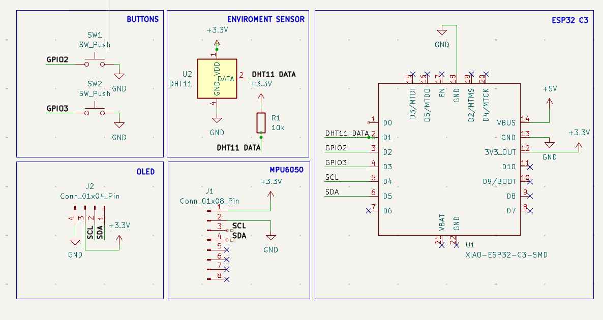
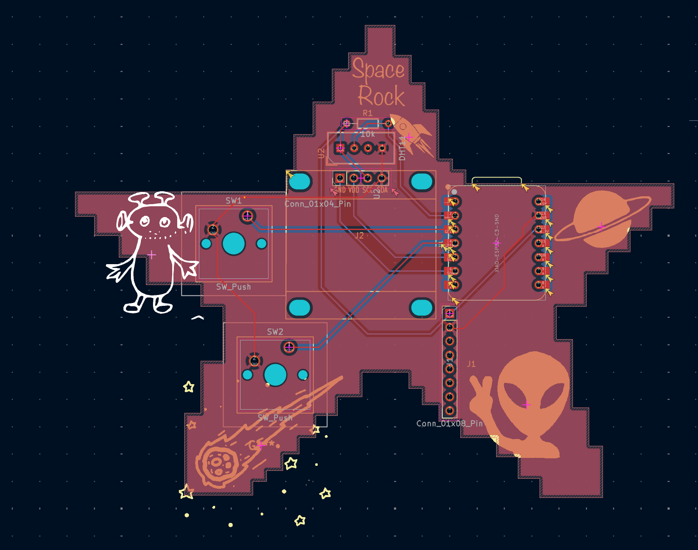

Space-Pet-Starbie

A Starbie is an interactive pet powered by a XIAO ESP32-C3 microcontroller. It features an OLED display for expressions, an MPU6050 6-axis IMU for motion tracking, and a DHT11 sensor for temperature and humidity monitoring.

Features & Hardware
- MCU: XIAO ESP32-C3
- Display:OLED Display (SSD1306)
- Sensors: MPU6050 IMU & DHT11 Temp/Humidity Sensor
- Custom PCB Designed in KiCad
  I changed up the design and made my own theme.

Bill of Materials (BOM)

| Part | Quantity | Unit Price | Link |

Seeed Studio XIAO ESP32-C3 | 1 | $4.99 | [Link](https://www.seeedstudio.com/XIAO-ESP32C3-p-5432.html) |
SSD1306 OLED Display (0.96") | 1 | $3.50 | [Link](https://www.amazon.com) |
MPU6050 IMU Module | 1 | $2.50 | [Link](https://www.amazon.com) |
 DHT11 Temperature & Humidity Sensor | 1 | $1.50 | [Link](https://www.amazon.com) |
 Custom KiCad PCB | 1 | - | - |

 
Project Images

Project Images
  Schematic

  PCB Layout

